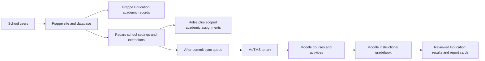

# Target system architecture

Padars runs once per independent school, on a Frappe site and database that
also install Frappe Education. Multiple school sites may share a Bench.

## Ownership

| Capability | Owner |
| --- | --- |
| Students, academic years, terms, Programs, Courses, enrollments, Student Groups, Instructors, dated schedules, assessments, attendance | Frappe Education |
| School profile, annual curriculum adoption snapshot, annual Course Offering, academic assignment scope | Padars |
| Tenant/user/course/enrollment mappings, desired/observed sync state, retries, monitoring | Padars |
| Lessons, assignments, quizzes, activities, online progress, instructional gradebook | Moodle |
| Final reviewed academic outcomes and published school report cards | Education records plus Padars approval/publication workflow |
| Authentication federation and SSO | A separately verified identity integration |

Education remains authoritative for its academic lifecycle. Padars adds a
record only where it owns a separate lifecycle or Education has a confirmed
functional gap. No Moodle content-delivery or activity model is duplicated.

## Current implementation versus target

The current branch contains shared-site School Membership checks and selected
Education school-context fields. Those mechanisms were built under the
superseded provisional decision in ADR-001. They must be audited, simplified,
or removed in Phase 1; this architecture page does not claim the target
permissions are implemented.

The current Moodle adapter is deterministic mock behavior. The local Moodle
code tree is Moodle 5.2.4 with MuTMS 5.2.4.01, but enabled web-service
functions, capabilities, tenant configuration, and SSO are not yet verified.
See [Moodle integration](moodle-integration.md) and the version baseline.
