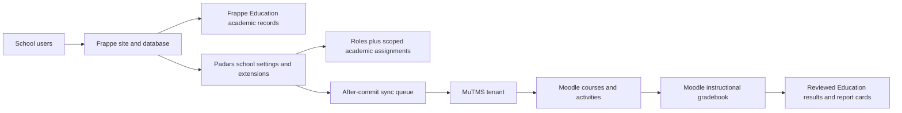

# Target system architecture

Padars runs once per independent school, on a Frappe site and database that
also install Frappe Education. Multiple school sites may share a Bench.

## Ownership

| Capability | Owner |
| --- | --- |
| Students, academic years, terms, Programs, Courses, enrollments, Student Groups, Instructors, dated schedules, assessments, attendance | Frappe Education |
| School profile, annual curriculum adoption/version, annual Course Offering, academic assignment scope | Padars |
| Tenant/user/course/enrollment mappings, desired/observed sync state, retries, monitoring | Padars |
| Lessons, assignments, quizzes, activities, online progress, instructional gradebook | Moodle |
| Final reviewed academic outcomes and published school report cards | Education records plus Padars approval/publication workflow |
| Authentication federation and SSO | A separately verified identity integration |

Education remains authoritative for its academic lifecycle. Padars adds a
record only where it owns a separate lifecycle or Education has a confirmed
functional gap. No Moodle content-delivery or activity model is duplicated.

## Current implementation versus target

Phase 1 uses one active School per site and within-school Academic Assignments
for scoped access. School Membership remains as historical affiliation and is
not an authorization prerequisite. See [permissions](permissions.md) for the
implemented boundaries and remaining restrictions. Phase 2 adds a setup page,
workspace, and record-based onboarding steps.

Phase 4 reuses Education Programs, Courses, Academic Years/Terms, Program
Enrollments, and Student Groups. Padars adds grade/stream metadata, an immutable
annual curriculum snapshot, class-section fields on Education Student Groups,
and idempotent generation of the existing annual School Course Offering. See
[curriculum model](curriculum-model.md) and
[ADR-006](../decisions/ADR-006-curriculum-adoption.md).

The current Moodle adapter is deterministic mock behavior. The local Moodle
code tree is Moodle 5.2.4 with MuTMS 5.2.4.01, but enabled web-service
functions, capabilities, tenant configuration, and SSO are not yet verified.
See [Moodle integration](moodle-integration.md) and the version baseline.
