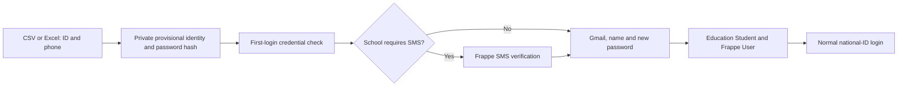

# Phase 3 progress and verification

Date: 2026-11-05. Phase 3 remains **in progress**; do not treat this as a
release approval. See [identity architecture](../architecture/student-registration.md).

## Import upload root cause and fix

Frappe's `frappe.handler.upload_file` calls `check_write_permission`. For an
unsaved parent name, that function checks a new, untyped Data Import document.
The Padars manager permission hook denied it because its reference DocType was
unknown. A controlled browser trace as a School Manager returned HTTP 403 and
`Data Import ... not found` / `Not allowed via controller permission check`.
The former server-side test used a saved parent and therefore did not reproduce
the browser request. A typed, saved Student Identity import draft now precedes
upload; the same private upload returned HTTP 200. A regression test exercises
both parent states using Frappe's actual permission function.

The temporary test server had initially remained running with stale code after
its client exited. A clean, explicitly site-pinned process was used for final
verification. Before that correction, three unsuccessful synthetic logins may
have created authentication-log or rate-limit entries on the Bench default site
`kara.loc`; no real credentials were used. No later browser test targeted it.

School managers can access only their own Student Identity imports and their
private attachments. The native File creation exception for an initially empty
file URL applies only to private Student Identity import attachments. Other
Data Import and File authorization continues to use Frappe's native rules.

## Current implementation

The initial phone credential cannot create a Frappe session. Completion locks
the provisional identity, requires a Gmail address and password confirmation,
creates narrowly scoped records, and deletes the provisional password hash in
the same transaction. Gmail syntax is checked; ownership is not verified.
Public applications and manager approval remain separate. Existing Students can
be reconciled by a manager through the Student form; conflicts require manual
review. Native Education Student creation and its import provider are not
globally blocked or replaced.

For recovery, a manager must first verify the student through the school's own
process, then use **Reset Pending First Login** to replace the provisional phone
credential. Activated Users use Frappe's normal reset process. Protect the
site encryption key and backups: changing the key without a planned identity
reconciliation breaks existing keyed identity lookups.

## Verification and acceptance matrix

| Requirement | Status | Evidence or remaining work |
| --- | --- | --- |
| Staff and returning-student registration | PASS | Focused Padars tests cover individual registration and enrollment drafts. |
| CSV/Excel import | NOT TESTED | Real browser CSV import succeeded; Excel parser tests passed, but Excel execution was not browser-tested. |
| SMS-disabled first login | PASS | Browser journey passed before the final shared-phone field change; focused tests cover the current flow. |
| Gmail and password replacement | PASS | Browser journey and focused tests; Gmail ownership is not verified. |
| Initial phone password invalidated | PASS | Browser and focused tests. |
| National-ID login after activation | PASS | Browser and focused tests. |
| SMS-enabled flow | BLOCKED | Mocked tests passed; no real SMS gateway is configured on the disposable site. |
| Public applications and approval | NOT TESTED | Focused server tests passed; current browser flow was not exercised. |
| Duplicate identities and concurrency | BLOCKED | Unique keyed reservations and row locking exist; concurrent claims were not stress-tested, and identity-less native Students need reconciliation. |
| Native Education compatibility | NOT TESTED | Focused native Student/API checks passed; the complete Education suite was not run. |
| School-manager permissions | FAIL | Import/file isolation passed, but the existing `Academics User` role grants write access to other Users on the test site. This broader pre-existing permission needs review. |
| Automated regression | NOT TESTED | Latest focused run: 32 Padars registration tests passed. A full Padars suite was not rerun after the current changes. |
| Browser verification | NOT TESTED | One real CSV-to-first-login journey and negative access checks passed before the final shared-phone field change; final build and Excel browser flow remain untested. |
| Risks and external dependencies documented | PASS | See below. |

Six older tests remain skipped: they assume the superseded two-school shared-site
model. They were not counted as passing. No other app's test suite was run.

## Risks and operational requirements

- The requested SMS-disabled fallback is lower assurance: anyone knowing the
  national ID and phone can claim the account first. A forced password change
  does not prove identity. Schools must explicitly accept this design risk.
- Frappe `User.mobile_no` is unique; the flow stores shared numbers in the
  non-unique `User.phone` field, also supported by Frappe's SMS 2FA fallback.
- Import private files and application status references contain sensitive
  information. Set retention/access rules and review request, proxy, worker,
  and error logs before real use. HTTP failure handlers suppress Frappe error
  snapshots for protected registration endpoints; infrastructure logging and
  all failure paths have not been exhaustively verified.
- SMS queueing occurs after commit. A queueing failure invalidates the code and
  records a generic failure; actual delivery is not confirmed by the UI.
- The consent checkbox is a declaration, not independent guardian verification.
- Apply schema changes only to a verified development site with the usual
  `bench --site <development-site> migrate`; do not migrate `kara.loc` without
  verifying and authorizing its environment. Review existing students and
  reconcile conflicts manually before relying on identity uniqueness.
