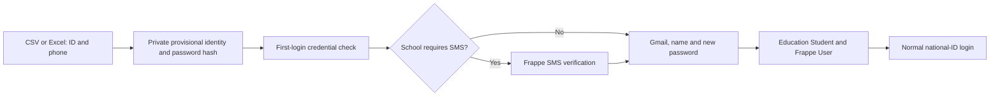

# Phase 3 implementation handoff

Date: 2026-11-05. Phase 3 is **implementation complete; integration and
production release verification pending**. This is a development handoff, not
production approval. See [identity architecture](../architecture/student-registration.md).

## Import upload root cause and fix

Frappe's `frappe.handler.upload_file` calls `check_write_permission`. For an
unsaved parent name, that function checks a new, untyped Data Import document.
The Padars manager permission hook denied it because its reference DocType was
unknown. A controlled browser trace as a School Manager returned HTTP 403 and
`Data Import ... not found` / `Not allowed via controller permission check`.
The former server-side test used a saved parent and therefore did not reproduce
the browser request. A typed, saved Student Identity import draft now precedes
upload; the same private upload returned HTTP 200. A regression test exercises
both parent states using Frappe's actual permission function.

The temporary test server had initially remained running with stale code after
its client exited. A clean, explicitly site-pinned process was used for final
verification. Before that correction, three unsuccessful synthetic logins may
have created authentication-log or rate-limit entries on the Bench default site
`kara.loc`; no real credentials were used. No later browser test targeted it.

School managers can access only their own Student Identity imports and their
private attachments. The native File creation exception for an initially empty
file URL applies only to private Student Identity import attachments. Other
Data Import and File authorization continues to use Frappe's native rules.

Education's `education.install.get_permissions()` installs a `Custom DocPerm`
giving `Academics User` level-0 read/write/create/export on User. Padars assigns
that role to school managers. Padars now scopes manager User queries and direct
document access to their own account and applies the same boundary to User
attachments. No Education permission row was changed; role and API credential
fields remain level-1. Student Identity import and Student creation remain
available through their intended Padars and Education paths.

The focused security tests cover another manager's User read/write denial,
list isolation, direct get/set, password change, private File visibility, and
Frappe's upload parent check. A final HTTP/browser upload-and-download check is
deferred to Phase 11. A previous pre-fix browser request confirmed the original
cross-User upload defect; the post-fix browser journey was not run.

## Current implementation

The initial phone credential cannot create a Frappe session. Completion locks
the provisional identity, requires a Gmail address and password confirmation,
creates narrowly scoped records, and deletes the provisional password hash in
the same transaction. Gmail syntax is checked; ownership is not verified.
Public applications and manager approval remain separate. Existing Students can
be reconciled by a manager through the Student form; conflicts require manual
review. Native Education Student creation and its import provider are not
globally blocked or replaced.

For recovery, a manager must first verify the student through the school's own
process, then use **Reset Pending First Login** to replace the provisional phone
credential. Activated Users use Frappe's normal reset process. Protect the
site encryption key and backups: changing the key without a planned identity
reconciliation breaks existing keyed identity lookups.

## Verification and acceptance matrix

| Requirement | Status | Evidence or remaining work |
| --- | --- | --- |
| Staff and returning-student registration | PASS | Focused Padars tests cover individual registration and enrollment drafts. |
| CSV/Excel import | PARTIAL | Native CSV execution and CSV/Excel parser tests passed. Excel browser execution and post-fix browser journey are deferred. |
| SMS-disabled first login | PASS | Focused tests cover current credential and onboarding behavior; final browser journey deferred. |
| Gmail and password replacement | PASS | Focused tests; Gmail ownership is not verified. Final browser journey deferred. |
| Initial phone password invalidated | PASS | Focused tests verify the old credential no longer authenticates; final browser journey deferred. |
| National-ID login after activation | PASS | Focused server tests pass; final browser check deferred. |
| SMS-enabled flow | PARTIAL | Mocked tests passed; no live provider or delivery check. |
| Public applications and approval | PARTIAL | Focused server tests passed; public browser flow deferred. |
| Duplicate identities and concurrency | PARTIAL | Unique keyed reservations and row locking exist; concurrent claims need stress testing. Identity-less legacy Students need reconciliation. |
| Native Education compatibility | PARTIAL | Focused Student/API checks pass; full Education regression suite deferred. |
| School-manager User/File permissions | PASS | 22 focused security tests pass, including direct User operations, private File checks, and upload-parent authorization. Final HTTP/browser verification deferred. |
| Automated regression | PARTIAL | 22 security tests passed after the final permission change; 32 registration tests passed earlier in this work. Full Padars and Education suites are deferred. |
| Browser verification | DEFERRED | No post-fix browser journey was run under the development-first workflow; verify in Phase 11. |
| Risks and external dependencies documented | PASS | See below. |

The full Padars suite was not rerun after these changes. An earlier full run had
50 passing tests and six superseded shared-site tests skipped. No other app's
test suite was run.

## Risks and operational requirements

- The requested SMS-disabled fallback is lower assurance: anyone knowing the
  national ID and phone can claim the account first. A forced password change
  does not prove identity. Schools must explicitly accept this design risk.
- Frappe `User.mobile_no` is unique; the flow stores shared numbers in the
  non-unique `User.phone` field, also supported by Frappe's SMS 2FA fallback.
- Import private files and application status references contain sensitive
  information. Set retention/access rules and review request, proxy, worker,
  and error logs before real use. HTTP failure handlers suppress Frappe error
  snapshots for protected registration endpoints; infrastructure logging and
  all failure paths have not been exhaustively verified.
- SMS queueing occurs after commit. A queueing failure invalidates the code and
  records a generic failure; actual delivery is not confirmed by the UI.
- The consent checkbox is a declaration, not independent guardian verification.
- The complete Frappe/Education endpoint permission audit and public-file access
  checks remain in the Phase 11 release backlog.
- Apply schema changes only to a verified development site with the usual
  `bench --site <development-site> migrate`; do not migrate `kara.loc` without
  verifying and authorizing its environment. Review existing students and
  reconcile conflicts manually before relying on identity uniqueness.
